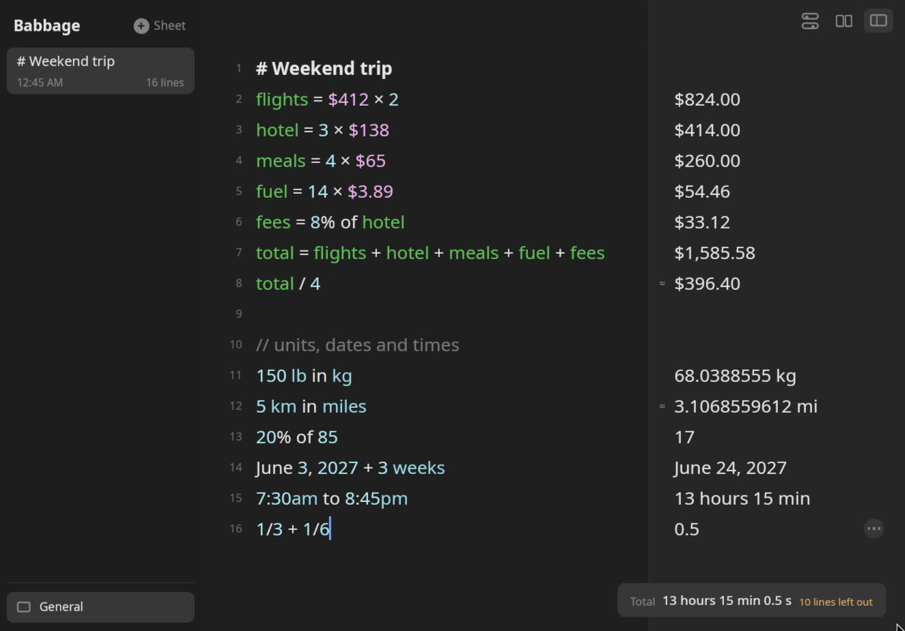

# Babbage

A notepad calculator for Linux. Write sums in plain language and the answer appears beside each line, exact until it
can't be. Percentages, units, money, dates and time zones all work, and every sheet is a plain text file you own.



```
hotel = 3 × $138               →  $414.00
$412 × 2 + hotel + 15%         →  $1,423.70
150 lb in kg                   →  68.0388555 kg
June 3 + 3 weeks               →  June 24
3 hours 20 minutes in seconds  →  12,000 s
```

It follows the Omarchy theme live, light or dark, and works offline. The calculation engine is also a Rust crate,
[`babbage-core`](#as-a-rust-crate), for use in your own programs.

## Install

```sh
curl -fsSL https://github.com/jrimmer/babbage/releases/latest/download/install.sh | bash
```

One line: it downloads the latest release, checks every file against its published `.sha256`, and installs it under
`~/.local`. No root is needed. Then:

- `babbage` opens the window, and Babbage is in your app launcher.
- `bbg 20% of 85` answers from a terminal (`17`), and `bbg budget.bbg` answers a sheet file. The installer sets up
  tab completion for bash; `bbg --completions fish` and `bbg --completions zsh` print scripts for those shells.

Run the same line again to update. Pass flags through `bash -s --`: `--tarball` installs the tarball instead of the
AppImage, and `--uninstall` removes only the files the installer wrote. Read the script first if you like; it is
`install.sh` in the [latest release](https://github.com/jrimmer/babbage/releases/latest).

### By hand

The release has an x86_64 AppImage and a tarball, each with a `.sha256` beside it:

```sh
sha256sum -c babbage-1.0.0-x86_64.AppImage.sha256
chmod +x babbage-1.0.0-x86_64.AppImage && ./babbage-1.0.0-x86_64.AppImage
```

`BABBAGE_RELEASE_URL` points the installer at a mirror. Babbage is built and tested on Wayland (Omarchy and
Hyprland); ARM builds are not published, so build from source there.

### From source

```sh
cargo build --release     # or bin/build: the same at low priority, and it builds the check runner too
target/release/babbage
```

The code uses Rust's edition 2024 and let chains, so it needs Rust 1.88 or later.

## On Omarchy

```sh
babbage setup omarchy
```

adds, each in a clearly marked place and with a backup of the file it touches:

- **Super+Alt+C** opens a small floating window for one calculation (`--key "SUPER + ALT + N"` picks another; it
  refuses a key that is already bound). Pressed again, it brings the open window forward.
- **Super+Space → Babbage**: Quick Calculation and Open Babbage in the Omarchy menu.

Hyprland's part lives in `~/.config/hypr/babbage.lua`, loaded by one line in `hyprland.lua`. If Hyprland reports a
configuration error after the change, every file is put back. `babbage setup omarchy --remove` undoes it all.

## Your sheets

Each sheet is one plain `.bbg` file in `~/.local/share/babbage`, saved as you type. Open it in any editor, keep it in
version control, or move it with `mv`. Export a sheet as text, CSV, HTML or PDF with Ctrl+Shift+E.

## As a Rust crate

The calculation engine is a separate crate, [`babbage-core`](https://crates.io/crates/babbage-core), with no interface
of its own. Hand it a line and it hands back an exact value:

```sh
cargo add babbage-core
```

```rust
use babbage_core::{FormatOptions, evaluate, format_value};

let value = evaluate("20% of 85")?;
let shown = format_value(&value, &FormatOptions::default());
assert_eq!(shown.text, "17");
```

Sheets, settings, number formats and what 1.x promises are in the
[developer guide](https://jasonrimmer.com/babbage/dev/).

## Documentation

The [user guide](https://jasonrimmer.com/babbage/guide/) covers every feature, chapter by chapter, with pictures.
The guide's sources for developers are in [docs/dev](docs/dev).
`bbg --help` lists the command-line options, and the decisions behind the behavior are in
[docs/decisions.md](docs/decisions.md).

## Network use

Babbage works offline. The only thing it can do online is look for a newer version of itself: when it starts, at
most once a week by default, it asks the release page (GitHub unless you change it) for its list of releases. The
request carries your IP address and nothing from your sheets or settings. You can turn it off in Settings,
Updates, or with `BABBAGE_UPDATES=off`, and then Babbage makes no requests at all. Everything it does and keeps is
written down in [docs/updates.md](docs/updates.md).

## Building and testing

```sh
bin/build      # release build
bin/check      # format, lint, licences and every unit test
bin/accept     # end-to-end checks against the real window, in a nested headless Hyprland
bin/package    # tarball, AppImage (when appimagetool is installed) and checksums, in dist/
```

`bin/accept` never opens a window on your desktop. The roadmap is in [docs/roadmap.md](docs/roadmap.md).

## Licence

MIT. See [LICENSE](LICENSE).
